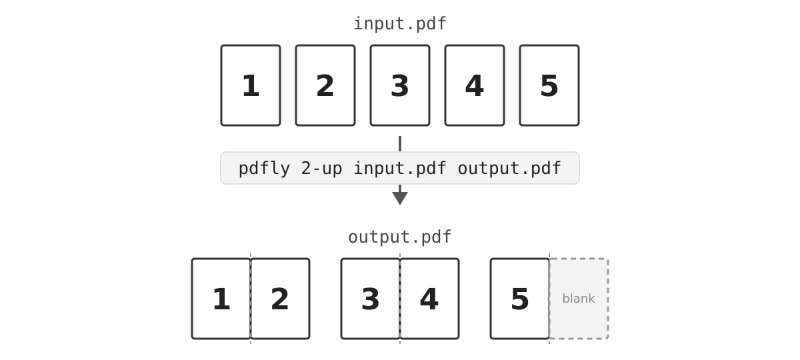

# 2-up

Put each pair of pages side by side on one page.



## Usage

```
$ pdfly 2-up --help
 Usage: pdfly 2-up [OPTIONS] {pdf} {out}

 Put each pair of pages side by side on one page.

 Pages 1 and 2 become the left and right half of the first output page,
 pages 3 and 4 the left and right half of the second one, and so on.
 If the number of pages is odd, the right half of the last output page
 stays blank. The page order is not changed; use `pdfly booklet` to
 reorder the pages for booklet printing.

 Example:
     pdfly 2-up input.pdf output.pdf

╭─ Arguments ──────────────────────────────────────────────────────────────────╮
│ *    pdf      <file>  [required]                                             │
│ *    out      <path>  [required]                                             │
╰──────────────────────────────────────────────────────────────────────────────╯
╭─ Options ────────────────────────────────────────────────────────────────────╮
│ --help        <bool>  Show this message and exit.                            │
╰──────────────────────────────────────────────────────────────────────────────╯
```

## Examples

Put the pages of `document.pdf` side by side, two per page, and write the
output to `2-up.pdf`:

```
pdfly 2-up document.pdf 2-up.pdf
```

To reorder the pages for printing a folded booklet, use `pdfly booklet`
instead.
