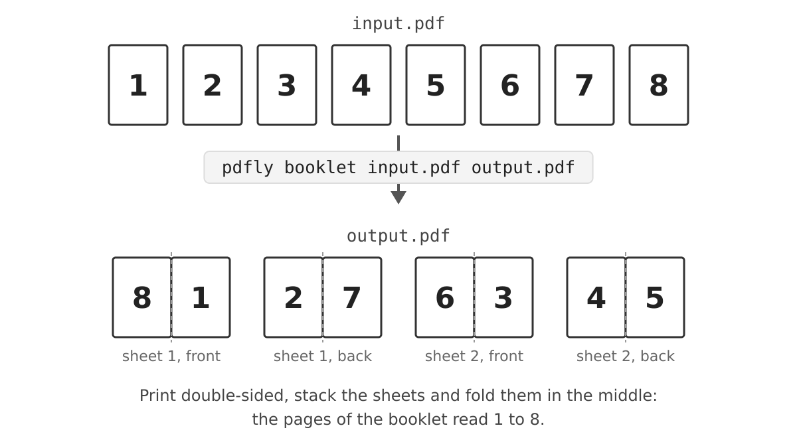

# booklet

Reorder and two-up PDF pages for booklet printing.



## Usage

```
$ pdfly booklet --help
 Usage: pdfly booklet [OPTIONS] {filename} {output}

 Reorder and two-up PDF pages for booklet printing.

 If the number of pages is not a multiple of four, pages are
 added until it is a multiple of four. This includes a centerfold
 in the middle of the booklet and a single page on the inside
 back cover. The content of those pages is from the
 centerfold-file and blank-page-file files, if specified, otherwise
 they are blank pages.

 Example:
     pdfly booklet input.pdf output.pdf

╭─ Arguments ──────────────────────────────────────────────────────────────────╮
│ *    filename      <file>  [required]                                        │
│ *    output        <file>  [required]                                        │
╰──────────────────────────────────────────────────────────────────────────────╯
╭─ Options ────────────────────────────────────────────────────────────────────╮
│ --blank-page-file  -b      <file>  page added if input is odd number of      │
│                                    pages                                     │
│ --centerfold-file  -c      <file>  double-page added if input is missing >=  │
│                                    2 pages                                   │
│ --help                     <bool>  Show this message and exit.               │
╰──────────────────────────────────────────────────────────────────────────────╯

```

## Examples

Convert `document.pdf` into a booklet and write the output in `booklet.pdf`.
```
pdfly booklet document.pdf booklet.pdf

```
