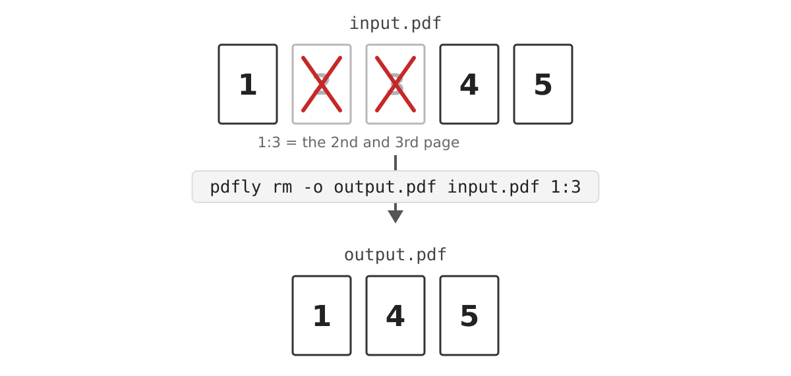

# rm

Remove pages from PDF files.



## Usage

```
$ pdfly rm --help
 Usage: pdfly rm [OPTIONS] {filename} {fn_pgrgs}...

 Remove pages from PDF files.

 Page ranges refer to the previously-named file.
 A file not followed by a page range means all the pages of the file.

 PAGE RANGES are like Python slices.

         Remember, page indices start with zero.

         When using page ranges that start with a negative value a
         two-hyphen symbol -- must be used to separate them from
         the command line options.

         Page range expression examples:

             :     all pages.                   -1    last page.
             22    just the 23rd page.          :-1   all but the last page.
             0:3   the first three pages.       -2    second-to-last page.
             :3    the first three pages.       -2:   last two pages.
             5:    from the sixth page onward.  -3:-1 third & second to last.

         The third, "stride" or "step" number is also recognized.

             ::2       0 2 4 ... to the end.    3:0:-1    3 2 1 but not 0.
             1:10:2    1 3 5 7 9                2::-1     2 1 0.
             ::-1      all pages in reverse order.

 Examples
     pdfly rm -o output.pdf document.pdf 2:5

         Remove pages 2 to 4 from document.pdf, producing output.pdf.

     pdfly rm document.pdf -- -1

         Removes the last page from document.pdf, modifying the original file.

     pdfly rm document.pdf :-1

         Removes all pages except the last one from document.pdf, modifying the original file.

     pdfly rm report.pdf :6 7:

         Remove all pages except page seven from report.pdf,
         producing a single-page report.pdf.

╭─ Arguments ─────────────────────────────────────────────────────────────────────────────────────────────╮
│ *    filename         <file>       [required]                                                           │
│ *    fn_pgrgs...      <list[str]>  filenames and/or page ranges [required]                              │
╰─────────────────────────────────────────────────────────────────────────────────────────────────────────╯
╭─ Options ───────────────────────────────────────────────────────────────────────────────────────────────╮
│ *  --output   -o                  <path>  [required]                                                    │
│    --verbose      --no-verbose    <bool>  show page ranges as they are being read [default: no-verbose] │
│    --help                         <bool>  Show this message and exit.                                   │
╰─────────────────────────────────────────────────────────────────────────────────────────────────────────╯
```

## Examples

Remove the 5th page of `document.pdf`, modifying the original file.

```
pdfly rm document.pdf 4

```

Remove the first and last page of `document.pdf`, producing `output.pdf`.

```
pdfly rm -o output.pdf document.pdf 1:-1

```
